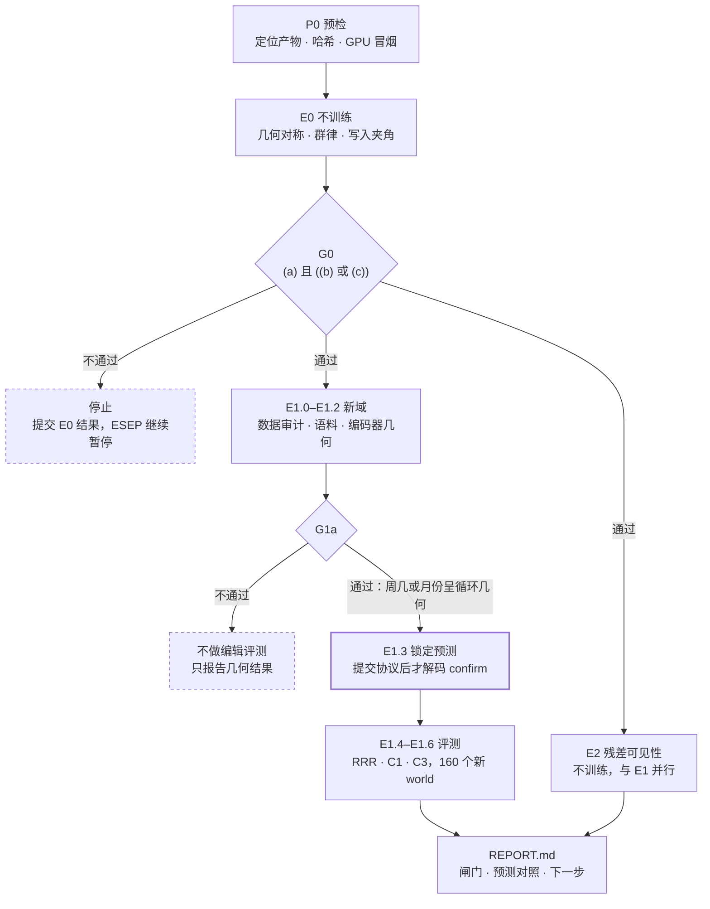

# ESEP 实验计划：语言统计对称性与潜空间编辑的可组合性（symmetry\_composability\_v1）

Nov 22, 2026 · @Zailong Tian

## 归属与目标

这是 ESEP 的实验，不是 IsoProbe 的。代码与结果放在 ESEP 仓库的新分支 `experiment/symmetry-composability-v1`，目录为 `experiments/symmetry_composability_v1/`。

判断依据：

- **研究问题属于 ESEP**：因变量是连续潜空间编辑的单步成功率、R\_k 和续步失败，这正是 ESEP 的核心问题。
- **全部输入都在 ESEP**：冻结的 BART-base、受控语义世界、四域生成器与评测器、C1/C3/RRR 编辑器、operator\_residual\_v2 的残差。
- **与 IsoProbe 没有交集**：IsoProbe 研究最后一层各向异性与 γ/W\_U 尺度约定，用 Pythia/OLMo checkpoint，没有编辑，也没有续步。两者只共用“表示几何”这个词，混放会模糊两篇论文的贡献边界。

本轮只回答一个问题：**一个属性在语言统计里具有编辑所假设的对称性时，冻结编码器是否把这个编辑表示为可反复执行的线性群作用；没有这种对称性时，是否就不存在这样的编辑？**

执行顺序：

1. **P0 预检**：定位并哈希全部输入，做一次 GPU 冒烟测试。
2. **E0（不训练，闸门）**：测四个现有域的几何对称性、现有算子的群律和相邻规范写入的夹角。G0 不通过就停止。
3. **E1（前瞻预注册）**：新增五个域，先测语料与编码器的对称性并锁定预测，再在 160 个新 world 上评测 RRR、C1、C3。G1a 不通过就不做编辑评测。
4. **E2（不训练，与 E1 并行）**：区分“曲率让残差变得可见”和“编辑后离开流形才变得可见”。

**执行流程 · 两道闸门**：G0 决定是否继续，预测在确认集评测前锁定。



G0 不通过就停在 E0；E1 的预测在 confirm 解码之前锁定；E2 在 G0 通过后与 E1 并行。

## 给 Claude Code 的执行规则

以下规则优先于本文其他内容。违反任何一条都要停下，写入 `DEVIATIONS.md` 并报告。

### 分支与目录

- 从 `origin/experiment/manifold-controls-v1` 新建分支 `experiment/symmetry-composability-v1`，它包含最新的 canonical\_\* 与 operator\_residual\_v2 代码。
- 所有新文件放在 `experiments/symmetry_composability_v1/`。不修改任何已有实验目录，只 import。
- 四域的生成器、评测器和 `Backend` 通过服务器上的 `.four-domain-worktree` 导入，方式与 `experiments/operator_residual_v2/core.py` 相同。

### Slurm 与 GPU（硬约束）

- 所有 Python 计算（GPU 和 CPU）都用 `sbatch` 提交，作业内用 `srun` 启动。登录节点只做 git、文件读写、`squeue`/`sinfo`/`sacct`，以及 E1.1 的一次语料下载。
- 每个入口脚本开头调用 `require_slurm()`，检查 `SLURM_JOB_ID` 和 `SLURM_STEP_ID`，与现有实验一致。
- **任何时刻，本人名下正在使用的 GPU 不超过 2 张**，其他项目的作业也计入。每个 GPU 作业只申请 `--gres=gpu:1`。
- 只开两条 GPU 通道（A、B）。同一通道内的 GPU 作业严格串行：除通道首个作业外，每个都依赖同通道上一个 GPU 作业的真实 ID（`--dependency=afterok:<id>`）。本人若另有 GPU 作业在跑，只开一条通道。
- 通道首个作业提交前运行 `gpu_guard.sh`（见“作业编排与资源”）。正在用的 GPU 加上本作业超过 2 张，就等待，不提交。
- 用 `sbatch --parsable` 获取真实 job ID。依赖只写真实 ID，不用预估的作业号；历史作业 3353–3356 就是因此被取消。
- 分区：先查 `sinfo`，默认用仓库一直使用的 `B300q`，避开 drain/down 节点，并记录到 `run_ledger.json`。
- 不在后台起常驻进程。`srun --pty` 只用于 10 分钟以内的排错。

### 预算

- GPU 分配时间总上限 **10 GPU 小时**，按 `sacct` 的 `ElapsedRaw` 乘以分配的 GPU 数累计。到 8 小时先报告剩余计划，到 10 小时立即停止。
- 每个作业的 `--time` 不超过“作业编排与资源”中的值。长作业必须能续跑：按分片输出，已完成的分片跳过。

### 冻结与防泄漏

- BART-base 冻结，revision 必须与 `models/manifest.json` 一致。除 E1.4 列出的 C1/C3 训练外，不训练任何参数。
- 模型选择只用 train 内部划分或 dev。`protocol.json` 锁定并提交之前，不得在 confirm world 上生成任何编辑后状态的解码。
- 所有输入写入 `inputs_manifest.json`（路径、SHA256、大小），脚本运行时按现有 `verify()` 的方式校验。
- RRR 是确定性闭式解，不能当作多个 seed。编辑器 seed 固定为 42、43、44。

### 提交与推送

- 每完成一个编号单元（P0、E0.1、E0.2、E0.3、G0、E1.0 …）提交一次并推送到 origin。提交信息为 `symcomp: <编号> <一句话结果>`。
- 提交代码、协议、`results/` 下的 JSON/CSV/JSONL、图、`REPORT.md` 的对应小节和 `run_ledger.json`。
- 不提交 `local/`（编码缓存、编辑器权重、latents），只在 manifest 里记录 SHA256 与大小。超过 50 MB 的单个文件不入 git。

### 偏差与停止

- 任何与本文不同的做法（换分区、改模板、补跑等）写入 `DEVIATIONS.md`：时间、原因、影响、发生在锁定前还是锁定后。锁定后不得修改预测或阈值。
- 遇到以下任一情况就停止：闸门未通过；预算超限；同一作业连续失败 2 次且原因不明；发现测试泄漏。停止时提交已有结果和报告，写明停在哪一步。

## 背景与可证伪假设

Karkada 等（ICML 2026 spotlight）证明，共现统计具有平移对称时，词表示由傅里叶模式构成：月份成圈，年份成开口曲线。后续工作把它推广为：统计在群 G 下不变，表示就由 G 的不可约表示构成。

由此推出，一次平移在每个 cos/sin 平面里都是一次旋转，存在正交、可逆、可组合的线性编辑。ESEP 的现有结果与此相容，但检验很弱：时间域里可组合的链全部在 yesterday、today、tomorrow 三个状态之间往返。

| 编号 | 假设 | 支持它的结果 | 否定它的结果 |
| --- | --- | --- | --- |
| H-sym（主） | 编辑能否反复执行，取决于编码器几何在编辑群下是否近似等距；这种几何源自语言统计的对称性 | 对称分数高的域，RRR/C3 的长链与闭包成功率高；周几、月份可以绕圈；方位词好于自我中心方位词 | 对称域也不可组合，或可组合性与对称分数无关 |
| H-curv | “残差当前不可见、下一步可见”源于流形弯曲：解码器在不同状态读取不同方向 | 把同一残差放到规范的下一状态上（transport），KL 与 post 相当，远大于 pre | transport 的 KL 接近 pre，可见性来自 CE 编辑后离开流形 |
| H-ce | CE 训练的编辑器走解码器捷径，与属性几何无关 | 新域里 C1 第二步就失败，C3 能恢复 | C1 在对称域里可组合 |

H-sym 决定 ESEP 是否改写论文主线；H-curv 和 H-ce 只用于解释机制。

## 复用的代码与产物

所有路径相对仓库根目录，服务器工作树为 `/dataset1/zailong/workspace/encrypted_semantic_editing_pilot`。找不到的产物，先在相应实验的 `local/` 与 `*_complete.json` 中按 SHA256 查找；仍找不到就停下报告，不得重新生成替代品。

| 用途 | 路径 | 说明 |
| --- | --- | --- |
| BART 编码、解码、CE | `.four-domain-worktree/experiments/four_domain_state_coverage_v1/backend.py` 的 `Backend('bart')` | 输入填充到 `config.json` 的 `source_cap`；贪心解码 |
| 四域生成与评测 | 同目录 `semantics.py`（`render`、`gold`、`advance`、`states`、`relation`）、`evaluator.py`（`score`）、`data/{domain}/worlds.jsonl` | 每域 152 个 world，按 96/24/32 划分 |
| 公共函数 | `experiments/operator_residual_v2/core.py`：`pool`、`logits`、`distribution`、`evaluate`、`basis`、`random_basis`、`matched_random` | `pool` 是有效 token 的均值 |
| RRR 闭式拟合 | `experiments/canonical_write_reachability_v1/fit.py`：`paired_tokens`、`sufficient`、`solve` | 白化交叉协方差后 SVD 截断，截距不受惩罚 |
| 时间域 RRR | `experiments/canonical_write_reachability_v1/local/rrr.pt`，键 `('iid_only', op, 16)` | 行向量约定：Δ = h·left·right + bias |
| C1/C3 配置与权重 | 配置：`experiments/canonical_objective_v1/protocol.json` 的 `training`，脚本 `train_c.py`；权重：`canonical_objective_v1/local/{C1,C3}_s{42,43,44}_0600.pt`、`canonical_confirmation_v1/local/time_{C1,C3}_s{45,46}_0600.pt` | 600 次更新，batch 8，AdamW 1e-3，clip 1 |
| 时间域基线 | `experiments/manifold_controls_v1/local/{CE_all,floor,adv_pool_l0.01,adv_set_l0.01}_s{42,43,44}.pt`，用 `mutil.baseline_editor` 加载 | 训练覆盖全部 12 个合法转换 |
| 人称 RRR | `experiments/manifold_controls_v1/local/person_fits.pt`，键 `(op, rank)`，rank ∈ {16, 64, 256, 768} | 只拟合对齐的 1↔2 转换 |
| 人称 C1/C3 | `experiments/canonical_confirmation_v1/local/person_{C1,C3}_s{seed}_0600.pt`（`futils.model` 的命名） | 不存在则在 E0.2 标为 NA |
| 规范编码缓存 | `canonical_write_reachability_v1/local/{split}_t{t}_s{s}.pt`；`canonical_confirmation_v1/local/{domain}_{split}_t{t}_s{s}.pt` | 字段 `h`、`m`、`world_ids` |
| E2 残差产物 | `experiments/operator_residual_v2/interventions.py` 的 `attribution()`、`visibility()`；协议中的 `eval_world_ids`、`random_seeds`；S 基 `.causal-next-edit-worktree/.../local/pca/bart_s{seed}.pt` | 80 个历史 eval world，探索性 |
| G3 参照数值 | `experiments/algebraic_generalization_v1/residual_dynamics.csv`、`jacobian_spectrum.csv` | 只引用，不重跑 |
| Slurm 模板 | `experiments/manifold_controls_v1/job.slurm`、`job_cpu.slurm` | 复制后改作业名、日志路径和 `--time` |

`Editor` 用列向量约定：Δ = b + U·V·h，其中 `v.weight` 是 V（r×d），`u.weight` 是 U（d×r）。

新建文件（都在 `experiments/symmetry_composability_v1/` 下）：

- 文档与记录：`PLAN.md`（本文导出）、`protocol.json`、`inputs_manifest.json`、`DEVIATIONS.md`、`REPORT.md`、`run_ledger.json`。
- 公共：`symutil.py`（`require_slurm`、读写、哈希、Procrustes、群平均、Wilson、bootstrap）、`job_gpu.slurm`、`job_cpu.slurm`、`gpu_guard.sh`。
- P0 与 E0：`p0_preflight.py`、`p0_smoke.py`、`e0_encode.py`、`e0_geometry.py`、`e0_operators.py`、`e0_writes.py`、`g0_decide.py`。
- E1：`sym_semantics.py` 与 `sym_evaluator.py`（互不 import）、`e1_make_data.py`、`e1_audit.py`、`e1_corpus.py`、`e1_encode.py`、`e1_geometry.py`、`e1_lock.py`、`e1_fit_rrr.py`、`e1_train.py`、`e1_eval.py`、`e1_algebra.py`、`e1_analyze.py`。
- E2：`e2_visibility.py`、`e2_analyze.py`。

## P0 预检

预检应在 2 小时内完成，只用 1 个 GPU 作业；任何一步失败都停止。

1. 新建分支和目录，复制两个 Slurm 模板，写 `.gitignore`（排除 `local/`）。把本文导出为 `PLAN.md` 一并提交。
2. 提交 CPU 作业 `p0_preflight.py`：
   - 定位“复用的代码与产物”表中的每一项，写入 `inputs_manifest.json`（路径、SHA256、大小、来源实验）。
   - 确认 `.four-domain-worktree` 和 `.causal-next-edit-worktree` 存在。
   - 确认 `models/manifest.json` 中 BART-base 的 revision 为 `aadd2ab0ae0c8268c7c9693540e9904811f36177`。
3. 提交 GPU 冒烟作业 `p0_smoke.py`（1 卡，≤15 分钟）：
   - 编码 8 条四域时间模板 0 的规范文本并解码，`evaluator.score` 全部判为成功。
   - 对其中状态为 +1 的样本应用时间域 RRR-16 的 plus，解码后目标状态 0 判为成功。
4. 写 `run_ledger.json` 的第一条记录，提交并推送 `symcomp: P0 preflight`。

## E0：不训练的闸门实验

E0 不训练任何参数，约 1 天，GPU 用量 ≤1 小时。它决定 E1 和 E2 是否值得做。

### E0.1 编码器几何的对称性（四个现有域）

- **数据**：四域 `data/{domain}/worlds.jsonl` 的全部 152 个 world。它们都用过，结果只作探索性。
- **文本**：用 `semantics.render(world, state, template)` 生成。
  - time：模板 0，7 个状态（−3 … +3）。
  - person：模板 0，3 个状态。
  - space：模板 0 和模板 1，4 个状态；模板 1 的 front/right/back/left 都是单 token。状态按 `semantics.relation(world, heading)` 得到的关系词编号，不按朝向编号；plus 下的循环顺序由代码确认（预期 front → left → back → right）。
  - emotion：模板 0，5 个状态。
- **表示**：编码器最后一层，fp32，用 `core.pool` 取有效 token 均值；每个 world 内对状态去均值。
- **指标**（定义见附录）：
  - E\_iso（仿射等距等变误差）及其标签置换零分布。
  - 距离矩阵的群平均 R² 及零分布，只用于状态数 ≥4 的域。
  - SEP（跨 world 的共享程度）。
  - time 的三状态片段 {+1, 0, −1} 单独算 E\_iso，用来和 person 比较。
  - 4 状态域另报告对边不对称 Δ\_opp（front–back 与 right–left 的距离差）。
- **作业**：1 个 GPU 编码作业（≤30 分钟，约 4.5k 条文本，存为 `local/e0_{domain}_t{t}.pt`），1 个 CPU 指标作业（≤1 小时）。
- **输出**：`results/e0_geometry.json`、`results/e0_geometry_null.csv`、`figs/e0_state_pca.png`（每域状态质心的前两个主成分）。

### E0.2 现有算子的群律

- **算子**：
  - time：C1、C3（seed 42–46）；RRR-16（确定性）；CE\_all、floor、adv\_pool\_l0.01、adv\_set\_l0.01（seed 42–44）。
  - person：RRR，rank 16/64/256/768；C1、C3（若存在）。
- **指标**（每个算子的 plus 与 minus，定义见附录）：
  - 核心矩阵 A\_Q 的奇异值（等距偏差 ISO、最小与最大奇异值）、特征值的模长与相位、谱半径、非正规度 NN。
  - 逆律误差 e\_inv(T₋∘T₊) 与 e\_inv(T₊∘T₋)：在对齐的规范状态对上按 token 计算，以 world 为单位做 bootstrap。time 用 canonical\_confirmation 的 160 个确认 world（已暴露，探索性）。
  - 偏置漂移 DRIFT：偏置落在写入列空间之外的比例。
  - 迭代增长（探索性）：k = 1 … 50 时的 ‖A\_Q^k‖，以及环 L = A₋A₊ 的 ‖L^k‖。与 `canonical_confirmation_v1/results/fresh_closure_summary.json` 中 C3 在 20 步和 50 步的实测闭包对照，只报告相关，不作预测。
- **输出**：`results/e0_operators.json`、`figs/e0_spectra.png`。

### E0.3 相邻两步的规范写入夹角

- **规范路径**：四域 time 模板 0，用 canonical\_confirmation 的 160 个确认 world（缺少的状态编码由 e0\_encode 补齐），plus 方向 +3 → −3，共 6 步。每个 world 的规范写入为 w\_k = pool(E(y\_k)) − pool(E(y\_{k−1}))，相邻余弦 c\_k = cos(w\_k, w\_{k+1})，k = 1 … 5，按 world bootstrap。
- 只有 (+1→0, 0→−1) 这一对两步都 mask 对齐，另算 token 级余弦。其余四对都含改变长度的“扭结”转换（−2↔−1、1↔2），单独标注。
- **编辑器对照**（只算潜变量，不解码）：在同样的 160 个 world 上，C1、C3、RRR-16 从 E(y₊₁) 连续 plus 两次，计算两次更新的余弦；CE\_all 沿 +3 → −3 连续 plus 6 次。G3 的 .519/.927/.967/.969 只作参照，因为生成器不同。
- **理想模型参照**：按论文开边界情形的指数核，c = −(1 − e^{−δ/σ})/2，落在 (−0.5, 0)。
- **输出**：`results/e0_writes.json`、`figs/e0_writes.png`。

### 闸门 G0

由 `g0_decide.py` 机器判定，结果写入 `results/g0_decision.json`。

- **(a) 几何**：time 7 状态的 E\_iso 低于其置换零分布的 5% 分位，Toeplitz R² 高于零分布的 95% 分位；并且 time 三状态片段的 E\_iso 低于 person，差值的 bootstrap 95% CI 不含 0。
- **(b) 弯曲**：(+1→0, 0→−1) 的池化规范余弦，其 95% CI 上界 < 0.5。
- **(c) 群律**：每个 seed 都有 e\_inv(C3) < e\_inv(C1)，RRR-16 的 e\_inv 低于所有 C1；且至少 4/5 个 seed 满足 ISO(C3) < ISO(C1)。
- **判定**：(a) 成立，且 (b) 或 (c) 至少一个成立 → 进入 E1 和 E2。否则停止，把 E0 写成报告，并建议 ESEP 继续暂停。
- 无论是否通过，E0 的全部结果都要提交。

## E1：前瞻预注册的新域检验

E1 是本轮的主检验。看到任何编辑结果之前，先用语料和编码器几何登记各域的预测，再在每域 160 个新确认 world 上验证。

### E1.0 新域与数据

| 域 | 群 | 状态 | 模板 0 句式 | plus |
| --- | --- | --- | --- | --- |
| weekday | Z7 | Monday … Sunday（各 1 个 BPE token） | `The {o} event is scheduled for {X}. Its status is {status}. {fact}` | 后移一天，Sunday → Monday |
| month | Z12 | January … December（各 1 个 token） | 同 weekday | 后移一月，December → January |
| compass | Z4 | north, east, south, west（各 1 个 token） | `In {a}'s report, the {o} is on the {X} side. {fact}` | 顺时针 90° |
| egoside | Z4 | front, right, back, left（各 1 个 token） | 同 compass | front → right → back → left → front |
| daysago | 开边界，8 个状态 | two … nine days ago（各 3 个 token） | `The {o} event is dated {X}. Its status is {status}. {fact}` | 多一天（two → three），nine 为边界 |

- `{fact}` 沿用四域：`The {o} is {col}. There are {q} copies.`，数量为 1 时用单数。world 字段沿用四域 `make_worlds`：3 个人名、object、color、quantity、status。
- compass 与 egoside 句式完全相同，只换词表，是本轮最干净的对照。
- **模板 3（结构 OOD）**：每域设计一个改变从句结构的模板，属性词仍在句中且前有空格，例如 `{a} noted that the {o} event is scheduled for {X}, and {b} agreed. ...`。它不参与任何拟合或训练。
- **划分**：每域 train 96、dev 32、confirm 160。confirm 的核心键（people、object、color、quantity、status）与四域、canonical\_confirmation、manifold\_controls 的所有历史 world 文件互斥，随机种子写入协议。
- 每个 world 预先抽一个起始状态，供单向链使用，写入数据文件。
- `sym_semantics.py` 提供与四域相同的接口：`states`、`advance`、`render`、`gold`。`sym_evaluator.py` 独立解析文本，返回字段与 `evaluator.score` 一致（success、属性值、非目标事实是否保持、语法是否完整消费）。两个文件互不 import。

**审计（`e1_audit.py`）**：任一项不通过就修模板，修好之前不进入 E1.1。

1. 每域、每模板、每个状态的金标准文本，经 `sym_evaluator` 判为成功的比例为 100%。
2. 每个相邻转换在所有 world 上的 attention mask 完全相同（BART 分词）。
3. 渲染文本在 world 之间不重复；各 split 的核心键互不重叠。
4. 输出每个模板、每个状态的 token 数表。

### E1.1 语料对称性（CPU）

- **语料**：wikitext-103-raw-v1 的 train 部分，在登录节点下载一次（约 0.5 GB），计算节点不联网。下载失败就跳过 E1.1 并记入 DEVIATIONS，编码器几何仍是主指标。
- **方法**：窗口 ±5，取前 50k 高频词作上下文。对每个词表成员计算 PPMI 上下文向量，余弦相似度转为距离，再按域的群算群平均 R² 和标签置换零分布。
- **变体**：去掉词表成员彼此作为上下文的计数，只靠“辅助词”，对应论文删除月份同句共现的做法。
- **细节**：weekday 和 month 保留首字母大写，另报告去掉 May 的结果。daysago 用短语计数；某短语出现少于 200 次时改用 two … nine 数词，并记录。
- **输出**：`results/e1_corpus.json`。

### E1.2 编码器几何（只用 train 和 dev）

- 指标与 E0.1 相同：E\_iso、群平均 R²、SEP、Δ\_opp。模板 0 为主，模板 3 为辅。
- **停止规则 G1a**：weekday 和 month 的 E\_iso 都没有低于各自零分布的 5% 分位，说明 BART-base 编码器连标准循环域都不呈现预期几何。此时不做编辑评测，直接报告。

confirm world 的规范编码在协议锁定之后才计算，E1.2 只编码 train 和 dev。

### E1.3 锁定协议与预测

`e1_lock.py` 把下列内容写入 `protocol.json` 并提交，记录提交哈希和文件 SHA256。此后才能在 confirm 上解码编辑后的状态。以下预测均用 confirm 的 160 个 world、模板 0、以 world 为单位，给 Wilson 95% CI。

| 编号 | 预测 | 通过条件 |
| --- | --- | --- |
| P1 | 循环域绕一圈：RRR-16 单向 plus 的 R\_N ≥ 80%（weekday N = 7，month N = 12） | 两域都达到 |
| P2 | 绕两圈：RRR-16 的 R\_2N ≥ 70% | 两域都达到 |
| P3a | 几何：E\_iso(compass) < E\_iso(egoside) | 差值的 bootstrap CI 不含 0 |
| P3b | 可组合：RRR-16 单向 plus 的 R\_8(compass) − R\_8(egoside) ≥ 20 个百分点 | 双比例检验 p < 0.05 |
| P4 | 开边界：daysago 的 RRR-16 从 two 单向走到 nine，R\_7 ≥ 70%；交替 10 步的 R\_10 ≥ 70% | 两项都达到 |
| P5 | CE 捷径：所有新域中，C1 在单向 plus 链上的 R\_2 ≤ 20%；C3 在 weekday 和 month 上 R\_N ≥ 70% | 每个 seed 都成立 |
| P6 | 闭包代数：weekday 和 month 的 RRR-16 闭包误差比 κ\_N 中位数 < 0.5 | 两域都成立 |
| P7 | 5 个新域上，E\_iso 与 RRR-16 六步存活率 S6 = R\_6^{1/6} 的 Spearman ρ | 只报告，不判定（n = 5） |

协议还要锁定：域、模板、划分与种子、指标定义、RRR 秩网格（主秩 16）、ridge 网格、训练配置、链的路径与长度、成功的定义、分析脚本的 SHA256、停止规则。

### E1.4 拟合与训练

- **RRR**：每域每个操作，秩 {4, 8, 16, 32, 64, 128}；相对 ridge 网格 {1e-4, 1e-3, 1e-2, 1e-1}。只用 train 内部 80/16 划分的 token MSE 选 ridge，再在 96 个 train world 上重拟合，复用 `fit.py` 的 `solve`。只拟合模板 0。
- **C1（只用 CE）与 C3（CE + 规范 L2，权重 1）**：seed 42、43、44，600 次更新，其余与 `canonical_objective_v1` 的 `training` 配置相同。C3 的 `l2_scale` 取该域 train 上理想写入能量的均值。只用模板 0。共 5 域 × 2 组 × 3 seed = 30 次训练，每次约 1–3 分钟。
- **dev** 只做健全性检查：记录 RRR-16 与 C3 的单步成功率。低于 90% 的域照常进入确认集评测，但相关预测标为“准入失败，不可判定”。不用 dev 挑选秩或 checkpoint。

### E1.5 确认集评测（GPU）

- **方法**：RRR 各秩、C1 × 3、C3 × 3，以及 reencode（规范状态，作健全性参照）。
- **单步**：每个合法转换、每个 world，记录成功、逐字一致和非目标保持。
- **链**：
  - 循环域：从 world 预设的起点单向 plus 2N 步；单向 minus 2N 步；从状态 0 起 plus/minus 交替 2N 步。
  - daysago：从 two 单向 plus 7 步；从 nine 单向 minus 7 步；从 five 起交替 10 步。
  - 每一步保存解码文本、评分，以及池化与 token 级的潜变量范数。R\_k 为前 k 步全部成功的比例。
- **代数诊断**（`e1_algebra.py`）：RRR-16、C1、C3 的 ISO、NN、特征值相位、e\_inv、DRIFT；循环域另算 κ\_N。
- 输出按 16 个 world 分片写入 `results/shards/`，已存在的分片跳过，写法沿用 `mutil.run_eval`。

### E1.6 分析

- **预测对照表**：每条预测的阈值、观测值、CI 和是否通过。
- **图**：
  - 各域 R\_k 曲线，不同方法用不同颜色。
  - 秩曲线：单步成功率与 R\_N 随秩的变化。
  - E\_iso 与 S6 的散点，E0 的 time 片段与 person 作为历史参照单独标记。
  - 每域状态质心的 PCA。
- 历史参照只作对照，不参与 P1–P7 的判定。

## E2：曲率与残差可见性（不训练）

E2 用已有的 operator\_residual\_v2 产物区分两种解释：残差变得可见，是因为状态移到了流形上的另一处（H-curv），还是因为 CE 编辑后的状态离开了流形。

- **world 与条件**：operator\_residual\_v2 协议中的 80 个 eval world；seed 42、43、44；模板 0；当前状态 0，下一步操作为 plus（到 −1）。
- **残差**：沿用 `attribution()` 得到的 S\_perp 分量 e，S 与 S\_R 作补充；α ∈ {0.5, 1.0}。随机对照用协议中的 `random_seeds`，经 `matched_random` 生成等范数方向。
- **KL**：用 `core.logits` 和 `distribution`，定义与原 `visibility()` 完全相同：KL(参照‖扰动)，同一组 teacher-forcing 标签，排除 padding。

| 上下文 | 基准状态 | 评测文本 | 性质 |
| --- | --- | --- | --- |
| pre | E(y₀) | 状态 0 的文本 | 复现 |
| post | T\_CE(E(y₀))，operator\_residual\_v2 所用的同一 CE 编辑器 | 状态 −1 的文本 | 复现 |
| transport | E(y₋₁)，规范的下一状态 | 状态 −1 的文本 | 新增 |
| post\_RRR | T\_RRR16(E(y₀)) | 状态 −1 的文本 | 新增 |

- **几何补充**：e 落在规范时间子空间里的能量占比。该子空间由同一 world 七个状态的规范编码去均值后张成（token 级）。
- **判定**（α = 1，逐 seed 报告）：
  - 支持 H-curv：transport/post 的中位数比 ≥ 0.5，transport/pre ≥ 10，且随机方向的 transport KL 不超过真实残差的 0.2 倍；三个 seed 中至少两个满足。
  - 否定 H-curv：transport/post ≤ 0.2，说明可见性来自离开流形。
  - 其余情况报告为混合。
  - post\_RRR 应接近 transport；明显更大则说明 RRR 的输出也不在规范位置。
- 这些 world 已被评估过，E2 是探索性的机制分析，不是独立确认。
- **作业**：1 个 GPU 作业（≤1 小时）和 1 个 CPU 分析作业。G0 通过后即可提交，可与 E1 的 CPU 阶段并行。

## 作业编排与资源

全程最多两条 GPU 通道，每个作业 1 张卡；CPU 作业不占 GPU 配额，但同样通过 Slurm 提交。预计共用约 7 GPU 小时（P0 与 E0 约 1 小时，E1 约 5 小时，E2 约 0.5 小时），墙钟 3–4 天。

| 单元 | 作业 | 资源 | `--time` | 依赖 | 通道 |
| --- | --- | --- | --- | --- | --- |
| P0 | `p0_preflight` | CPU 4 核 | 00:30:00 | — | — |
| P0 | `p0_smoke` | 1 GPU | 00:15:00 | p0\_preflight | A |
| E0.1 | `e0_encode` | 1 GPU | 00:30:00 | p0\_smoke | A |
| E0.1 | `e0_geometry` | CPU | 01:00:00 | e0\_encode | — |
| E0.2 | `e0_operators` | 1 GPU | 01:00:00 | p0\_smoke | B |
| E0.3 | `e0_writes` | 1 GPU | 00:30:00 | e0\_encode | A |
| G0 | `g0_decide` | CPU | 00:15:00 | E0 全部 | — |
| E1.0 | `e1_make_data`、`e1_audit` | CPU | 00:30:00 | G0 通过 | — |
| E1.1 | `e1_corpus` | CPU 8 核、64G | 04:00:00 | 语料已下载 | — |
| E1.2 | `e1_encode`；`e1_geometry` | 1 GPU；CPU | 00:30:00；01:00:00 | e1\_audit | A |
| E1.3 | `e1_lock` | CPU | 00:15:00 | e1\_geometry，以及 e1\_corpus 或其跳过记录 | — |
| E1.4 | `e1_fit_rrr`、`e1_train` | 每通道 1 GPU | 01:00:00、02:00:00 | e1\_lock | A、B |
| E1.5 | `e1_eval`（按域分组的分片） | 每通道 1 GPU | 每组 03:00:00 | e1\_fit\_rrr、e1\_train | A、B |
| E1.6 | `e1_algebra`；`e1_analyze` | 1 GPU；CPU | 01:00:00；01:00:00 | e1\_eval | A |
| E2 | `e2_visibility`；`e2_analyze` | 1 GPU；CPU | 01:00:00；00:30:00 | G0 通过 | B |

E1.4 和 E1.5 的分配：通道 A 处理 weekday、month、daysago，通道 B 处理 compass、egoside。

`gpu_guard.sh`：提交每条通道的首个 GPU 作业前运行。它统计本人正在运行、以及排队且没有依赖的作业所占的 GPU；加上本作业超过 2 张就返回非零，此时等待后重试。

```bash
#!/bin/bash
# GPUs in use now, or able to start at once (pending without dependency).
need=${1:-1}
used=$(squeue -u "$USER" -h -t R,PD -o "%T|%E|%b" | awk -F'|' '
  { n=0; if (match($3, /gpu[:=]([A-Za-z0-9_]+[:=])?[0-9]+/)) { s=substr($3, RSTART, RLENGTH); k=split(s, a, /[:=]/); n=a[k] } }
  $1=="RUNNING" || ($1=="PENDING" && ($2=="" || $2=="(null)")) { u+=n }
  END { print u+0 }')
if [ $((used + need)) -gt 2 ]; then echo "GPU busy: ${used} in use"; exit 1; fi
echo "GPU ok: ${used} in use"
```

若集群的 `squeue` `%b` 输出格式不同，就调整正则，并记入 DEVIATIONS。

`job_gpu.slurm`（`job_cpu.slurm` 相同，只去掉 `--gres` 一行；`e1_corpus` 在命令行上改用 `--cpus-per-task=8`）：

```bash
#!/bin/bash
#SBATCH --job-name=symcomp
#SBATCH --nodes=1
#SBATCH --ntasks=1
#SBATCH --gres=gpu:1
#SBATCH --cpus-per-task=4
#SBATCH --mem=64G
#SBATCH --output=experiments/symmetry_composability_v1/logs/%j.out
set -euo pipefail
cd "${SLURM_SUBMIT_DIR:?}"
export OMP_NUM_THREADS=4 OPENBLAS_NUM_THREADS=4 MKL_NUM_THREADS=4 TOKENIZERS_PARALLELISM=false PYTHONUNBUFFERED=1 HF_HUB_OFFLINE=1 TRANSFORMERS_OFFLINE=1
srun .venv/bin/python "experiments/symmetry_composability_v1/${PHASE:?}.py" ${ARGS:-}
```

提交示例（通道 A 的首个作业及其后继）：

```bash
D=experiments/symmetry_composability_v1
p0=$(sbatch --parsable --partition=B300q --time=00:30:00 --export=ALL,PHASE=p0_preflight $D/job_cpu.slurm); p0=${p0%%;*}
bash $D/gpu_guard.sh 1 || exit 1
a1=$(sbatch --parsable --partition=B300q --time=00:15:00 --dependency=afterok:$p0 --export=ALL,PHASE=p0_smoke $D/job_gpu.slurm); a1=${a1%%;*}
a2=$(sbatch --parsable --partition=B300q --time=00:30:00 --dependency=afterok:$a1 --export=ALL,PHASE=e0_encode $D/job_gpu.slurm); a2=${a2%%;*}
printf '%s p0_preflight cpu\n%s p0_smoke A\n%s e0_encode A\n' "$p0" "$a1" "$a2" >> $D/logs/submitted.txt
```

每个作业结束后，用 `sacct -j <id> -X -n -P -o JobID,State,ElapsedRaw,AllocTRES` 记账，写入 `run_ledger.json`，并累计 GPU 小时。依赖作业因前驱失败而永久挂起（`DependencyNeverSatisfied`）时，先 `scancel`，查明原因后再重新提交。

## 输出与汇报

所有结果都在 `experiments/symmetry_composability_v1/` 下。`REPORT.md` 用中文，先给结论，再给闸门与预测对照表。

```text
experiments/symmetry_composability_v1/
  PLAN.md  protocol.json  inputs_manifest.json  DEVIATIONS.md  REPORT.md  run_ledger.json
  *.py  job_gpu.slurm  job_cpu.slurm  gpu_guard.sh
  data/      E1 新域的 world、渲染记录与审计结果
  results/   e0_*.json  g0_decision.json  e1_*.json  e2_*.json  shards/  *.csv
  figs/      *.png  *.svg
  logs/      <jobid>.out  submitted.txt
  local/     不入 git：编码缓存、编辑器权重、latents
```

`REPORT.md` 的结构：

1. **结论**（3–5 句）：G0 与 G1a 是否通过；H-sym、H-curv、H-ce 各自的判定；ESEP 是否继续的建议。
2. **闸门表**：条件、观测值、CI、是否通过。
3. **预测对照表**：P1–P7 的锁定阈值、观测值、CI、是否通过，以及锁定提交的哈希。
4. **E0、E1、E2 各一节**：一句话方法、主表、主图、适用边界。
5. **偏差与审计**：DEVIATIONS 摘要、泄漏检查、SHA 校验、GPU 用量（总 GPU 小时与峰值并发）。

写作与统计约定：

- 以 world 为统计单位。成功率给 Wilson 95% CI；连续量用 world bootstrap（2000 次，种子 3101）。
- 确定性方法（RRR、reencode）不算作多个 seed。
- 探索性结果与确认性结果分开标注；E0 与 E2 全部属于探索性。

提交节奏：每个编号单元提交一次并推送；闸门判定单独提交（`symcomp: G0 pass` 或 `symcomp: G0 fail`）；协议锁定单独提交（`symcomp: E1.3 lock protocol <sha256 前 12 位>`）。

## 不在本轮范围，以及结果之后

本轮只回答“对称性能否预测可组合性”。以下内容即使顺手也不做：

- E3 群结构编辑器（正交旋转、硬绑定逆、循环角量化、只用 CE 训练）：P1、P3、P5 成立后另写计划。
- decoder-only 模型或 T5Gemma 上的复现。
- 用 G3 做扭结去混淆（生成器不同）。
- HE/CKKS 的任何部分。
- 新的投影估计器或流形对抗方法。

| 结果 | 含义 | 下一步 |
| --- | --- | --- |
| G0 不通过 | 对称性视角在 BART 现有域上没有解释力 | ESEP 继续暂停，E0 放进现有稿件的附录 |
| G0 通过，G1a 不通过 | BART-base 编码器连标准循环域都不呈现预期几何 | 先评估换更大编码器的成本，再决定是否继续 |
| P1、P2、P3 成立 | 对称性能预测可组合性，主线成立 | 写 E3 计划；论文改为“统计对称 → 等变 → 可组合” |
| P1 成立，P3 不成立 | 循环域可组合，但统计对称与编码器几何的对应不清 | 以编码器几何为主线，语料对称性降为附录 |
| P5 不成立 | C1 在对称域可组合，CE 捷径依赖属性几何 | 修改 H-ce 的表述，补充 CE 写入的几何分析 |
| E2 支持 H-curv | path B 有几何解释 | 写进稿件的机制一节 |

## 附录：指标定义

记 E(·) 为冻结编码器最后一层，M 为 attention mask。world w 在状态 x 的池化表示为 v\_w(x) = pool(E(render(w, x, t)))；g 为 plus 映射，X\_g 为 g 有定义的状态集合。

### E\_iso：仿射等距等变误差

E\_iso = 0 表示 g 是表示上的等距作用。R = I、t = 0 是可行解，所以 E\_iso 不超过 1。

$$
E_{\mathrm{iso}}(w)=\frac{\min_{R\in O(d),\,t\in\mathbb{R}^{d}}\sum_{x\in X_g}\lVert R\,v_w(x)+t-v_w(gx)\rVert^{2}}{\sum_{x\in X_g}\lVert v_w(gx)-v_w(x)\rVert^{2}}
$$

- 解法：分别对 P = \[v\_w(x)\] 和 Q = \[v\_w(gx)\] 去均值，残差 = ‖P̃‖² + ‖Q̃‖² − 2‖P̃ᵀQ̃‖\_\*（核范数）。在两组点张成的子空间里计算（维数 ≤ 2|X\_g|），结果与全空间相同。
- 域级统计量是 world 均值，95% CI 用 world bootstrap。
- 零分布：对状态标签做随机置换 π，把 g 换成 π∘g∘π⁻¹，所有 world 用同一个 π。状态数 ≤ 7 时枚举全部置换，否则抽 1000 个（种子 3101）。报告观测值在零分布中的分位。

### 群平均 R²

D̄(x, x′) 为各 world 平方距离 ‖v\_w(x) − v\_w(x′)‖² 的均值；Π\_G 把同一轨道上的状态对取平均。

$$
R^{2}_{G}=1-\frac{\sum_{x<x'}\left(\bar D(x,x')-\Pi_G\bar D(x,x')\right)^{2}}{\sum_{x<x'}\left(\bar D(x,x')-\bar D_{\mathrm{mean}}\right)^{2}}
$$

- 循环群 Z\_N：按循环距离 min(|x − x′|, N − |x − x′|) 分组。开边界：按 |x − x′| 分组（Toeplitz）。
- 3 个状态的域：群在状态对上传递，R² 无定义，记为 NA，只看 E\_iso。
- 4 状态域另报告 Δ\_opp = (D̄(0, 2) − D̄(1, 3)) / 全部状态对的 D̄ 均值；Z4 预测它为 0。

### SEP：跨 world 共享程度

c\_w(x) 为 world 内去均值后的表示。

$$
\mathrm{SEP}=1-\frac{\sum_{w}\sum_{x}\lVert c_w(x)-\bar c(x)\rVert^{2}}{\sum_{w}\sum_{x}\lVert c_w(x)\rVert^{2}},\qquad \bar c(x)=\frac{1}{|W|}\sum_{w}c_w(x)
$$

### 算子核心矩阵（列向量约定）

- Editor：A = I + UV，U = `u.weight`（d×r），V = `v.weight`（r×d），偏置 b。
- RRR（行向量约定 Δ = h·left·right + bias）：U = rightᵀ，V = leftᵀ，b = bias。
- 取 Q = orth(\[U, Vᵀ\])（维数 ≤ 2r），A\_Q = QᵀAQ；A 在 Q 的正交补上是恒等映射。
- ISO = A\_Q 奇异值与 1 之差的均方根；NN = ‖A\_QA\_Qᵀ − A\_QᵀA\_Q‖\_F / ‖A\_Q‖\_F²；特征值取 A\_Q 的。
- DRIFT = ‖(I − P\_U)b‖ / ‖b‖，P\_U 为到 col(U) 的投影。

### 逆误差与闭包误差比

在对齐的规范状态对上按 token 计算，⊙ 表示只取 mask 内的有效 token。

$$
e_{\mathrm{inv}}=\frac{\lVert M\odot\left(T_{-}(T_{+}(E_x))-E_x\right)\rVert_F}{\lVert M\odot\left(E_{gx}-E_x\right)\rVert_F},\qquad \kappa_N=\frac{\lVert M\odot\left(T^{N}(E_x)-E_x\right)\rVert_F}{\lVert M\odot\left(T(E_x)-E_x\right)\rVert_F}
$$

### 相邻写入余弦

w\_k = pool(E(y\_k)) − pool(E(y\_{k−1}))，c\_k = cos(w\_k, w\_{k+1})；对齐的状态对另算 token 级版本（把有效 token 展平）。理想模型下，按指数核推得：

$$
c=-\frac{1-e^{-\delta/\sigma}}{2}\in\left(-\tfrac{1}{2},\,0\right)
$$

### 链与统计

- R\_k：前 k 步全部成功的 world 比例；条件续步率 r\_k = R\_k / R\_{k−1}；六步存活率 S6 = R\_6^{1/6}。
- 比例用 Wilson 95% CI；P3b 用双比例 z 检验；P7 用 Spearman ρ，只作描述。
- 连续量用 world bootstrap，2000 次，种子 3101。
- E2 的 KL 与 `core.distribution` 相同：KL(参照‖扰动)，同一 teacher-forcing 标签，排除 padding。

### 参考

- [Karkada et al., Symmetry in language statistics shapes the geometry of model representations（arXiv 2602.15029）](https://arxiv.org/abs/2602.15029)；[ICML 2026 spotlight 页面](https://icml.cc/virtual/2026/spotlight/84747)
- [Storan, Tolias, Miolane, Group-Invariant Statistics Determine Embedding Geometry（arXiv 2610.00647）](https://arxiv.org/pdf/2610.00647)
- [Wurgaft et al., Manifold Steering Reveals the Shared Geometry of Neural Network Representation and Behavior（arXiv 2605.05115）](https://arxiv.org/html/2605.05115v1)
- [Engels et al., Not All Language Model Features Are One-Dimensionally Linear（ICLR 2025）](https://arxiv.org/abs/2405.14860v3)
- ESEP 报告：[G4 代数性质](https://github.com/TTtianTT/encrypted_semantic_editing_pilot/blob/experiment/manifold-controls-v1/experiments/algebraic_generalization_v1/REPORT.md)、[规范写入可达性](https://github.com/TTtianTT/encrypted_semantic_editing_pilot/blob/experiment/manifold-controls-v1/experiments/canonical_write_reachability_v1/REPORT.md)、[对齐路径补充](https://github.com/TTtianTT/encrypted_semantic_editing_pilot/blob/experiment/manifold-controls-v1/experiments/canonical_write_reachability_v1/FOLLOWUP.md)、[五 seed 确认](https://github.com/TTtianTT/encrypted_semantic_editing_pilot/blob/experiment/manifold-controls-v1/experiments/canonical_confirmation_v1/REPORT.md)、[人称可达性与无对齐对照](https://github.com/TTtianTT/encrypted_semantic_editing_pilot/blob/experiment/manifold-controls-v1/experiments/manifold_controls_v1/REPORT.md)、[四域数据规范](https://github.com/TTtianTT/encrypted_semantic_editing_pilot/blob/experiment/four-domain-state-coverage-v1/experiments/four_domain_state_coverage_v1/DATA_SPEC.md)
